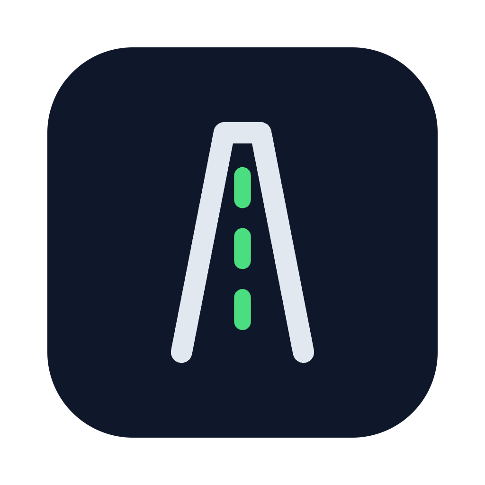
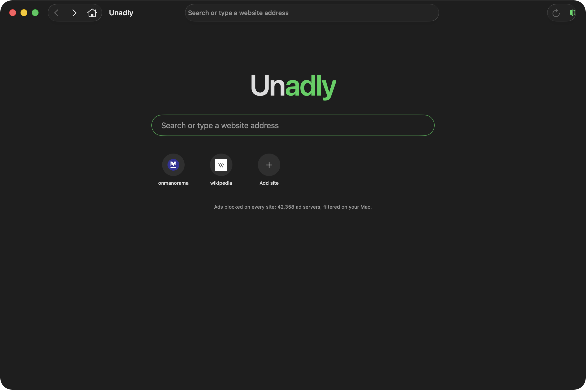

# Unadly

**A Mac web browser with ads blocked before they load.**

**[Download](https://github.com/salahu01/unadly-macos/releases/latest)** ·
**[Report an ad that got through](https://github.com/salahu01/unadly-macos/issues/new?template=ad-not-blocked.md)**

Open any site and the ads simply aren't there. Unadly blocks about 42,000 ad servers inside the
browser engine, so ad requests never leave your Mac, and pages load faster with less data. Popups
and popunders that sites open on their own are dropped too.

It runs on Apple's WebKit, the engine behind Safari, so sites, logins and video work the way
they do in Safari. No account, no server in between, no tracking. Free and open source.



## Features

**🚫 Ads blocked in the engine.** WebKit content rules, compiled once and cached, block requests to
known ad servers on every page and frame. Empty ad slots are hidden.

**🪟 No popups.** A window a page tries to open by itself is dropped. Links you click still open.

**📌 Pinned sites.** Pin a site with the ☆ button (<kbd>⌘D</kbd>) and it appears on the home page
with its icon.

**🔍 Search or address.** Type a site address or a search (DuckDuckGo) on the home page or in the
toolbar.

**▶️ Video and downloads.** Video, full screen and file downloads work as in Safari. Downloads go to
your Downloads folder and never overwrite an existing file.

**⌨️ Keyboard first.** <kbd>⌘L</kbd> address bar · <kbd>⌘R</kbd> reload · <kbd>⌘[</kbd> <kbd>⌘]</kbd>
back and forward · <kbd>⇧⌘H</kbd> home · <kbd>⌘N</kbd> new window.

## Install

1. Download `Unadly-<version>.dmg` from the [latest release](https://github.com/salahu01/unadly-macos/releases/latest).
2. Open it and drag **Unadly** into **Applications**.
3. First launch: if macOS says the app can't be checked, right-click **Unadly** in Applications and
   choose **Open**. (Builds without a Developer ID signature need this once.)

Requires macOS 14 Sonoma or later, on Apple silicon or Intel.

## Privacy

- Pages load straight from each website. There is no Unadly server.
- No analytics, telemetry or crash reporting.
- Searches go to DuckDuckGo. The app also fetches the icons of sites you pin.
- Pins are stored in the app's preferences on your Mac.

See [SECURITY.md](SECURITY.md) for what's stored where.

## Build from source

```bash
git clone https://github.com/salahu01/unadly-macos.git
cd unadly-macos
swift test                 # unit tests
./tools/bundle.sh          # build/Unadly.app (universal)
open build/Unadly.app
```

Requires Xcode 16 or later. See [CONTRIBUTING.md](CONTRIBUTING.md) for the project layout, the ad
list and releases.

## How ad blocking works

`Resources/adhosts.txt` lists ad-server hostnames. At launch, Unadly turns them into
[WebKit content rules](https://developer.apple.com/documentation/safariservices/creating-a-content-blocker)
(one rule per host, matching it and its subdomains when loaded as a third party) and compiles them
with `WKContentRuleListStore`. WebKit caches the compiled lists, so this happens only on first
launch or after the list changes. The list comes from
[anudeepND/blacklist](https://github.com/anudeepND/blacklist) (MIT) and is refreshed with
`./tools/update-blocklist.sh`.

## Contributing

Bug reports, missed ads, ideas and pull requests are welcome. Please read
[CONTRIBUTING.md](CONTRIBUTING.md) and the [code of conduct](CODE_OF_CONDUCT.md).

## License

[Apache License 2.0](LICENSE). The bundled ad list is MIT licensed; see [CREDITS.md](CREDITS.md)
and [NOTICE](NOTICE).
